# Gallery

Every dialog and every banner AestheticDialogs 2.0 ships, with the code that
produced it.

The images are not screenshots someone took once. They are rendered from the
real components by Robolectric and regenerated with:

```bash
scripts/generate-docs-images.sh
```

which means they cannot drift from the library. If a padding or a colour changes,
this page changes in the same commit. The sources are in
`aestheticdialogs/src/test/java/com/thecode/aestheticdialogs/Docs*.kt`.

- [Confirmation](#confirmation)
- [Alert](#alert)
- [Selection](#selection)
- [Input](#input)
- [Rich content](#rich-content)
- [Feedback](#feedback)
- [Notifications](#notifications)
- [Motion](#motion)
- [Dark theme](#dark-theme)

---

## Confirmation

Ask before doing something. `Destructive` is a separate type rather than a flag,
so a delete confirmation cannot ship with a neutral button by accident.

| Default | Destructive | Confirming |
|---|---|---|
| 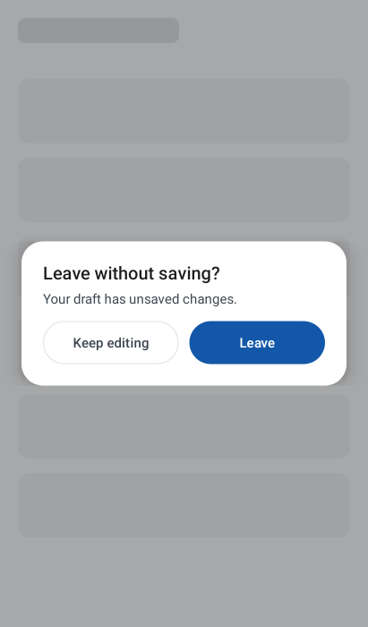 |  | 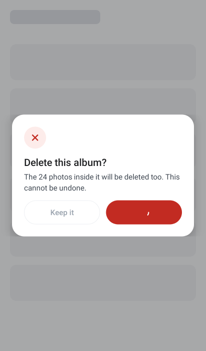 |

```kotlin
AestheticConfirmationDialog(
    uiModel = ConfirmationDialogUiModel.Destructive(
        title = "Delete this album?",
        message = "The 24 photos inside it will be deleted too. This cannot be undone.",
        confirmLabel = "Delete album",
        cancelLabel = "Keep it",
        isConfirming = uiState.isDeleting,
    ),
    onSignal = viewModel::onConfirmationSignal,
)
```

`isConfirming` puts a spinner on the confirm button and locks the whole dialog —
including cancel, so a half-finished delete cannot be abandoned mid-flight.

---

## Alert

Tell them something and offer a way forward. This is also the error, offline and
permission-required pattern: same dialog, different tone and label.

| Warning | Error |
|---|---|
| 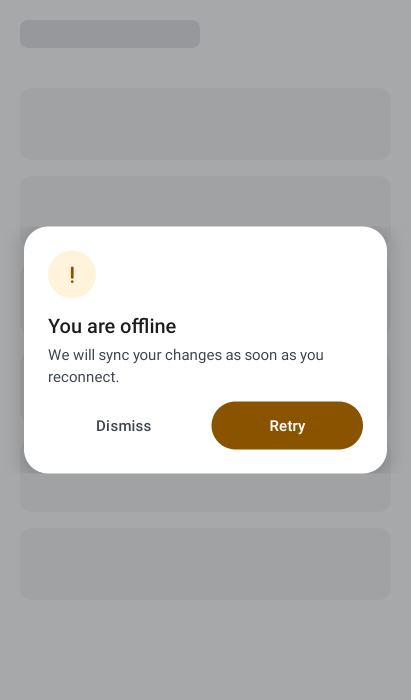 | 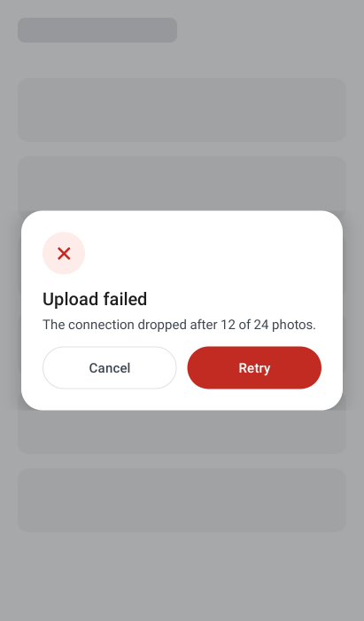 |

```kotlin
AestheticAlertDialog(
    uiModel = AlertDialogUiModel.Default(
        title = "You are offline",
        message = "We will sync your changes as soon as you reconnect.",
        tone = DialogTone.Warning,
        primaryAction = DialogAction("Retry"),
        secondaryAction = DialogAction("Dismiss", DialogActionEmphasis.Text),
    ),
    onSignal = { signal ->
        when (signal) {
            AlertDialogSignal.PrimaryActionClicked -> viewModel.retry()
            AlertDialogSignal.SecondaryActionClicked,
            AlertDialogSignal.Dismissed -> viewModel.dismissDialog()
        }
    },
)
```

---

## Selection

Pick one, or several. The dialog renders and reports; it never filters, sorts or
toggles, which is what lets the same component handle five static options and a
remote search over ten thousand rows.

| Single | Multiple, with search |
|---|---|
| 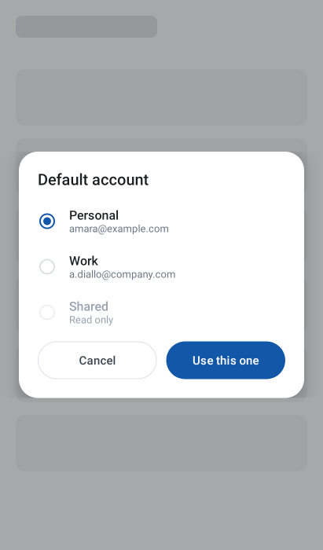 | 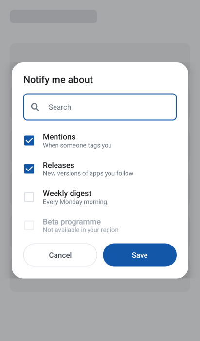 |

```kotlin
AestheticSelectionDialog(
    uiModel = SelectionDialogUiModel.Multiple(
        title = "Notify me about",
        items = uiState.filteredTopics,     // you filter
        selectedIds = uiState.selectedIds,  // you own the selection
        searchQuery = uiState.query,        // you own the query
        confirmLabel = "Save",
        cancelLabel = "Cancel",
    ),
    onSignal = { signal ->
        when (signal) {
            is SelectionDialogSignal.ItemClicked -> viewModel.toggleTopic(signal.id)
            is SelectionDialogSignal.SearchQueryChanged -> viewModel.search(signal.query)
            SelectionDialogSignal.Confirmed -> viewModel.saveTopics()
            SelectionDialogSignal.Cancelled,
            SelectionDialogSignal.Dismissed -> viewModel.dismissDialog()
        }
    },
)
```

Rows are `toggleable` at row level with a role, so TalkBack announces each one
once and correctly. Long lists are lazy and the action row stays pinned.

---

## Input

Ask for one value. The field takes focus on open, the keyboard's done action
confirms, the dialog lifts above the keyboard, and the reveal toggle survives
rotation.

| Text | Invalid | Password |
|---|---|---|
| 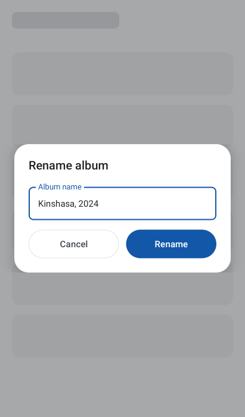 | 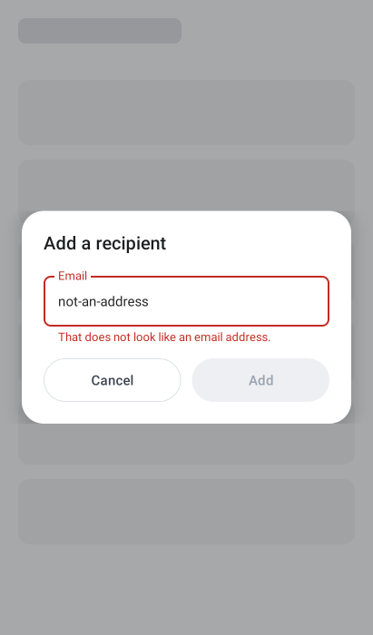 | 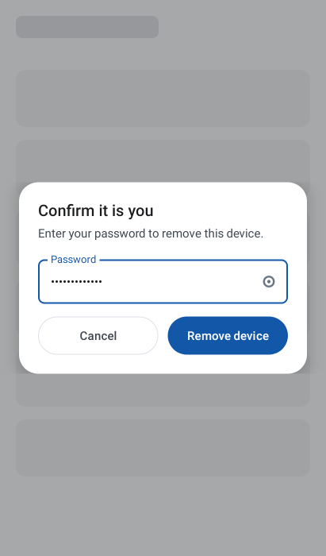 |

```kotlin
AestheticInputDialog(
    uiModel = InputDialogUiModel.Text(
        title = "Add a recipient",
        value = uiState.email,
        label = "Email",
        errorText = uiState.emailError,     // validation is yours
        confirmLabel = "Add",
        cancelLabel = "Cancel",
        isConfirmEnabled = uiState.emailError == null,
    ),
    onValueChange = viewModel::onEmailChange,
    onSignal = { signal ->
        when (signal) {
            InputDialogSignal.Confirmed -> viewModel.addRecipient()
            InputDialogSignal.Cancelled,
            InputDialogSignal.Dismissed -> viewModel.dismissDialog()
        }
    },
)
```

---

## Rich content

Your content, our frame. The window, adaptive width, scrim, dismissal contract,
header, actions and accessibility pane stay with the design system — which is the
difference between an escape hatch and a raw `Dialog {}`.

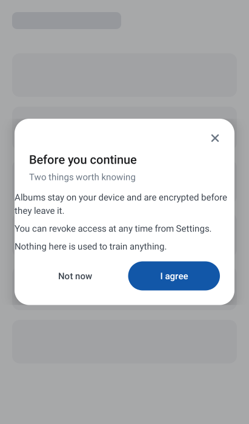

```kotlin
AestheticContentDialog(
    uiModel = ContentDialogUiModel.Default(
        title = "Before you continue",
        subtitle = "Two things worth knowing",
        primaryAction = DialogAction("I agree"),
        secondaryAction = DialogAction("Not now", DialogActionEmphasis.Text),
    ),
    onSignal = viewModel::onConsentSignal,
) {
    ConsentSummary(uiState.consent)
}
```

---

## Feedback

The 1.x dialogs, rebuilt. `Flat` is a card; `Flash` is a gradient panel derived
from the tone accent, so a rebranded theme keeps it consistent — and warning,
info and neutral finally have one.

| Flat | Flash, success | Flash, error |
|---|---|---|
| 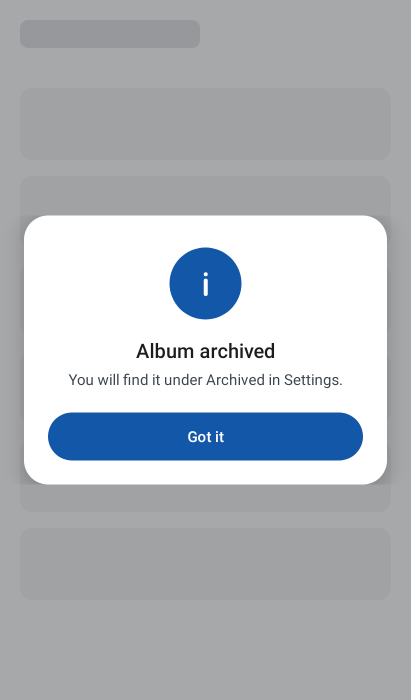 | 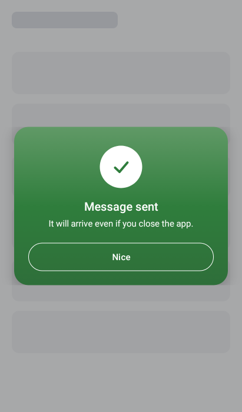 | 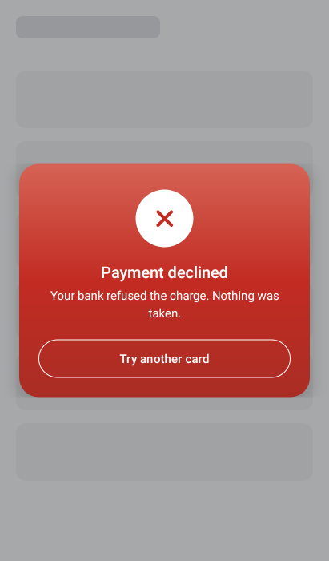 |

```kotlin
AestheticFeedbackDialog(
    uiModel = FeedbackDialogUiModel.Flash(
        title = "Message sent",
        message = "It will arrive even if you close the app.",
        tone = DialogTone.Success,
        actionLabel = "Nice",
    ),
    onSignal = { viewModel.dismissDialog() },
)
```

---

## Notifications

Five banners, not dialogs. They sit in your layout, announce themselves to screen
readers as a live region, and never take focus or swallow the back gesture.

| | |
|---|---|
| **Toaster** — tone bar down the leading edge | 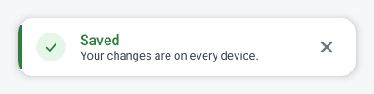 |
| **Rainbow** — tone-filled, inverted copy | 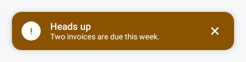 |
| **Connectify** — centred, under a tone rim | 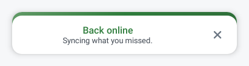 |
| **Emoji** — a character, not a bitmap | 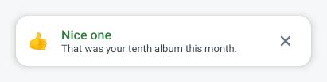 |
| **Emotion** — gradient card with a timestamp | 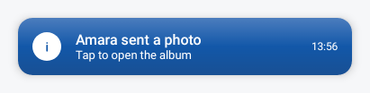 |

```kotlin
Box(Modifier.fillMaxSize()) {
    HomeContent()

    AestheticNotificationHost(
        notification = uiState.banner,
        onSignal = { viewModel.dismissBanner() },
        alignment = NotificationAlignment.Top,
        animation = AestheticNotificationAnimation.Slide,
        autoDismissMillis = 4_000,
    )
}
```

---

## Motion

The banner host owns the visibility of its notification, so it is the one place
in the library that runs a real exit transition as well as an enter. All three
collapse to an instant cut when the user has asked the system to remove
animations.

| `Slide` | `Fade` | `Scale` |
|---|---|---|
| 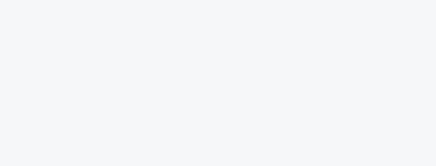 |  |  |

Recorded off the real component with the Compose clock stepped frame by frame, so
these play at the shipped durations rather than at a recorder's guess.

---

## Dark theme

Dark is a remapping of the same semantic roles, not a second implementation.
Nothing in a component knows which scheme it is drawing in.

| Alert | Selection | Banners |
|---|---|---|
| 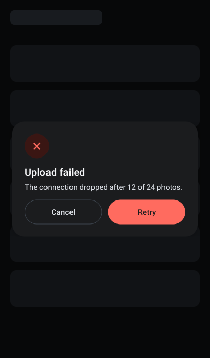 | 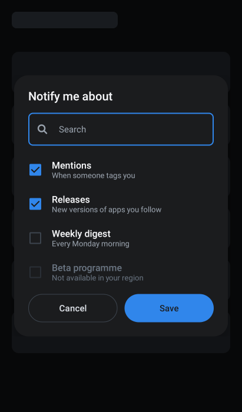 | 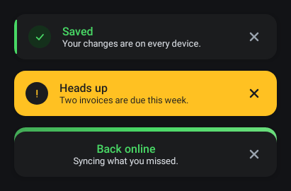 |
